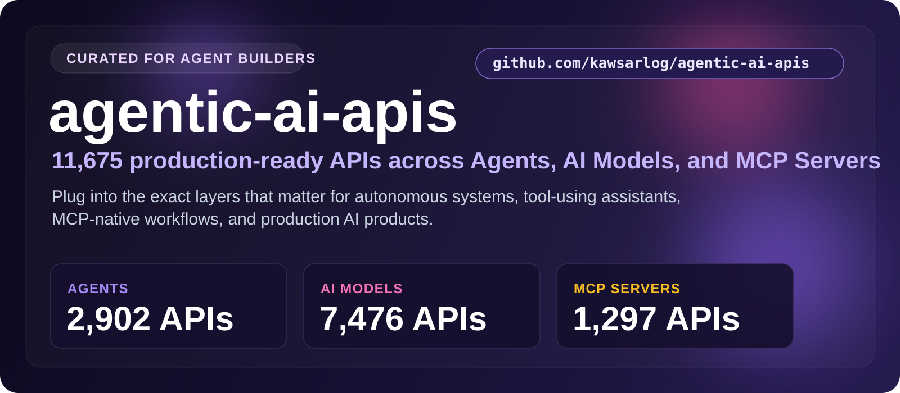

  

  <a href="#at-a-glance"><b>At a Glance</b></a> &nbsp;•&nbsp;
  <a href="#the-categories"><b>Categories</b></a> &nbsp;•&nbsp;
  <a href="#start-here"><b>Start Here</b></a> &nbsp;•&nbsp;
  <a href="#built-for"><b>Built For</b></a> &nbsp;•&nbsp;
  <a href="#why-this-repo"><b>Why This Repo</b></a>

## At a Glance

> **10,936** production-ready APIs across Agents, AI Models, and MCP Servers.

The layers that actually matter when you build autonomous systems: agents that act, models that reason, and MCP servers that connect assistants to real tools. Everything here is production-ready, rated, and refreshed daily — so you shortlist in minutes, not hours.

| Metric | Value |
|--------|-------|
| **Total APIs** | **10,936** |
| **Categories** | 3 |
| **Last updated** | 2026-07-16 |
| **Update cadence** | Daily, automated |

## The Categories

<table>
  <tr>
    <td width="33%" valign="top">
      <h3>Agents</h3>
      
<strong>2,661 APIs</strong>

      
Execution, orchestration, and autonomous task handling — the APIs closest to action.

      
<a href="./Agents/"><strong>Open Agents &rarr;</strong></a>

    </td>
    <td width="33%" valign="top">
      <h3>AI Models</h3>
      
<strong>7,124 APIs</strong>

      
Reasoning, generation, extraction, and analysis as a reusable service layer.

      
<a href="./AI/"><strong>Open AI Models &rarr;</strong></a>

    </td>
    <td width="33%" valign="top">
      <h3>MCP Servers</h3>
      
<strong>1,151 APIs</strong>

      
Model Context Protocol integrations that give assistants real tools and data.

      
<a href="./MCP_servers/"><strong>Open MCP Servers &rarr;</strong></a>

    </td>
  </tr>
</table>

## Start Here

1. Pick the category that matches what you're building.
2. Open its folder and scan the API names, ratings, and user counts.
3. Click through to the provider page for docs, pricing, and setup.
4. Shortlist in minutes — no digging through unrelated categories.

## Explore the Stack

<strong>Agents — 2,661 APIs</strong>

Execution, orchestration, and autonomous task handling — the APIs closest to action.

[Browse Agents APIs &rarr;](./Agents/)

<strong>AI Models — 7,124 APIs</strong>

Reasoning, generation, extraction, and analysis as a reusable service layer.

[Browse AI Models APIs &rarr;](./AI/)

<strong>MCP Servers — 1,151 APIs</strong>

Model Context Protocol integrations that give assistants real tools and data.

[Browse MCP Servers APIs &rarr;](./MCP_servers/)

## Built For

<table>
  <tr>
    <td width="25%" align="center"><strong>Autonomous agents</strong></td>
    <td width="25%" align="center"><strong>AI copilots</strong></td>
    <td width="25%" align="center"><strong>MCP toolchains</strong></td>
    <td width="25%" align="center"><strong>Research agents</strong></td>
  </tr>
  <tr>
    <td width="25%" align="center"><strong>Tool-using LLM apps</strong></td>
    <td width="25%" align="center"><strong>Workflow engines</strong></td>
    <td width="25%" align="center"><strong>Internal automation</strong></td>
    <td width="25%" align="center"><strong>Production AI features</strong></td>
  </tr>
</table>

## Why This Repo

- **Opinionated, not exhaustive.** Only the categories that matter here — no clutter.
- **Always fresh.** A scheduled job re-scrapes the source and updates the counts daily.
- **Fast to scan.** Ratings and real usage numbers surface the APIs worth your time.
- **Consistent.** Every category follows the same clean, sortable layout.

## Star History

---

**10,936 APIs** across **3 categories** — updated 2026-07-16
 If this saved you time, a star helps others find it.

